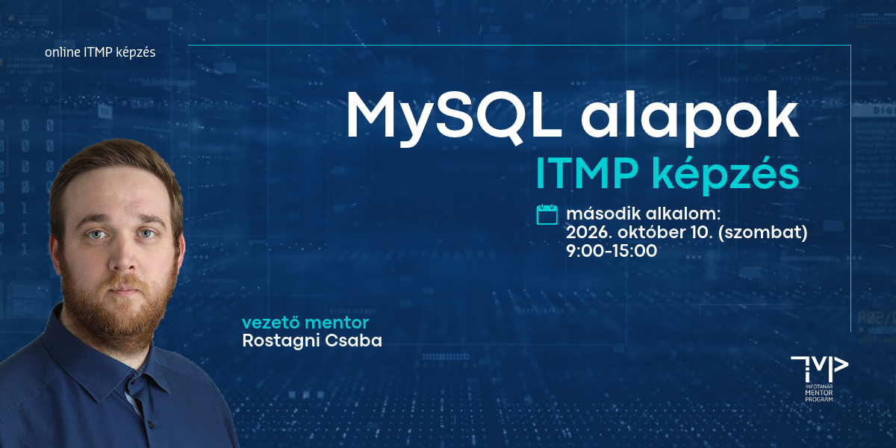

# Adatbázis-kezelés alapjai (MySQL) - 2. rész
## ITMP Klub képzés infotanároknak

Az egynapos, gyakorlatorientált képzés a MySQL alapok két részes tanári képzésünk első része, amely során **Rostagni Csaba** vezető mentor segítségével lépésről lépésre ismerkedhetsz további SQL utasítások felépítésével, használatával.  DDL és DML utasításokat, valamint allekérdezéseket készítesz, és magabiztos alapokat szerzel a többtáblás lekérdezések létrehozásánál a megfelelő összekapcsolási típusok használatában.

A képzés elsősorban Digitális kultúrát tanító kollégáknak szól, de a szakképzésben Adatbázis-kezelést oktatók is bátran csatlakozhatnak.

**A továbbképzés időpontja:** 2026. október 10. (szombat) 9:00-15:00

**A továbbképzés formája:** online (Microsoft Teams meeting)

**A képzés tervezett tematikája és ütemezése:**

| Időpont           |Téma                                                              |
|-------------------|------------------------------------------------------------------|
| *09:00 - 09:15*   | *Köszöntő, technikai információk*                                |
| **09:15 - 10:45** | **1. modul – Létrehozás és törlés**                              |
| 09:15 - 09:45     | 1. modul elméleti áttekintés - Rostagni Csaba                    |
| 09:45 - 10:45     | 1. modul workshop - kiscsoportos, mentorált gyakorlat            |
| _10:45 - 11:00_   | _Kávészünet_                                                     |
| **11:00 - 12:30** | **2. modul - Módosítás és megszorítások**                        |
| 11:00 - 11:30     | 2. modul elméleti áttekintés és demó - Rostagni Csaba            |
| 11:30 - 12:30     | 2. modul workshop - kiscsoportos, mentorált gyakorlat            |
| _12:30 - 13:30_   | _Ebédszünet_                                                     |
| **13:30 - 14:45** | **3. modul - Speciális lekérdezések**                            |
| 13:30 - 14:00     | 3. modul elméleti áttekintés és demó - Rostagni Csaba            |
| 14:00 - 14:45     | 3. modul workshop - kiscsoportos, mentorált gyakorlat            |
| _14:45 - 15:00_   | _Kérdések és válaszok, napzárás_                                 |