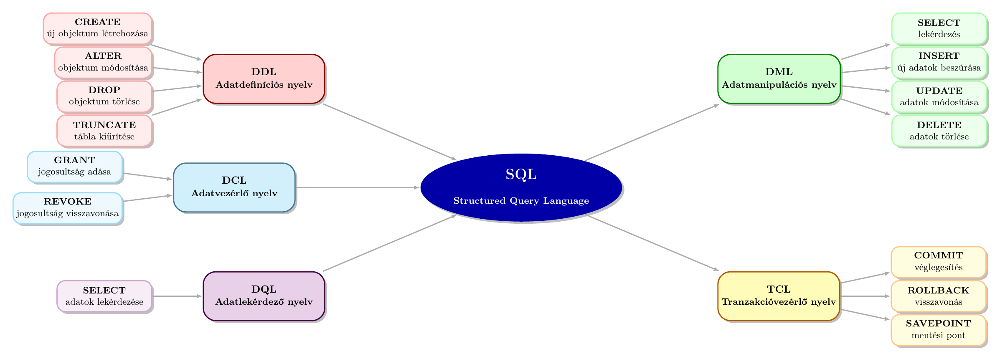

# 3. modul - Speciális lekérdezések

- Összekapcsolások típusai (JOIN)
    - INNER JOIN
    - LEFT OUTER JOIN
    - RIGHT OUTER JOIN
- Allekérdezések

## Összekapcsolások típusai (JOIN)


1. **INNER JOIN** - csak a közös adatok
2. **LEFT OUTER JOIN** - bal oldal minden sora, + jobb oldali egyezések
3. **RIGHT OUTER JOIN** - jobb oldal minden sora, + bal oldali egyezések
4. **FULL OUTER JOIN** - mindkét oldal minden sora (nem támogatott MySQL-ben!)
5. **CROSS JOIN** - összes lehetséges kombináció (descartes szorzat)
6. **NATURAL JOIN** - automatikus összekapcsolás azonos nevű oszlopok alapján
7. **SELF JOIN** - tábla összekapcsolása saját magával


---

## INNER vs OUTER JOIN


- Belső összekapcsolásnál (INNER JOIN) csak azok a sorok jelennek meg, ahol *mindkét* táblában van összeköthető adat.
- Külső összekapcsolásnál (OUTER JOIN) elég ha *valamelyik* oldalon van adat. Azon sorokhoz, melyekhez nem lehetett adatot találni a másik táblában, ott a hiányzó részek NULL értékekkel lesznek kitöltve.

**FONTOS:** A MySQL nem támogatja a FULL OUTER JOIN-t.


---

## INNER JOIN

```sql
SELECT oszlopok
FROM tabla1
    INNER JOIN tabla2
        ON tabla1.oszlop = tabla2.oszlop;
```


- Csak azok a sorok jelennek meg, ahol **mindkét táblában** van egyezés!


**Például:** Melyik tantárgyat melyik diák tanulja?

```sql
SELECT d.`keresztnev`, d.`vezeteknev`, t.`nev`
FROM `diakok` d
    INNER JOIN `diak_tantargy` dt
        ON d.`id` = dt.`diak_id`
    INNER JOIN `tantargyak` t
        ON dt.`tantargy_id` = t.`id`;
```


---

## LEFT OUTER JOIN


**DOKUMENTÁCIÓ:**
```sql
SELECT oszlopok
FROM tabla1
LEFT [OUTER] JOIN tabla2
ON tabla1.oszlop = tabla2.oszlop;
```


- A lekérdezés bal oldalán szereplő tábla **minden** sorát megjeleníti
- Ahol talált kapcsolódó rekordot a jobb táblából, azt megjeleníti
- Ahol **nem**, ott `NULL` értékek szerepelnek a jobb oldali oszlopokban


---

## LEFT OUTER JOIN példa

Melyik diáknak nincs még jegye?

```sql
SELECT d.`keresztnev`, d.`vezeteknev`, j.`ertek`
FROM `diakok` d
LEFT OUTER JOIN `jegyek` j  
    ON d.`id` = j.`diak_id`
WHERE j.`id` IS NULL;
```


- A WHERE záradékban ellenőrizzük, hogy nincs-e megfelelő sor a jobb oldali táblában.
- A `NULL` jelentése: nem találtunk jegyet ehhez a diákhoz.


---

## Férj és feleség példa adatbázis

Adott két tábla monogám kapcsolati viszonyokkal, így a táblák között `1:1` kapcsolat áll fenn:


**`ferj` tábla:**

| id | nev    | felesége |
|----|--------|-----------|
| 1  | Tamás  | NULL      |
| 2  | Laci   | 3         |
| 3  | Peti   | 1         |


**`feleseg` tábla:**

| id | nev    | ferje |
|----|--------|-------|
| 1  | Andrea | 3     |
| 2  | Emese  | NULL  |
| 3  | Nóra   | 2     |


**FIGYELEM:** Az itt látható táblatervezés nem megfelelő (nem normalizált), de a bemutatni kívánt anyagrész megértését elősegíti.


---

## LEFT OUTER JOIN példa: feleség → férj

```sql
SELECT * FROM
    `feleseg` LEFT OUTER JOIN `ferj`
        ON `feleseg`.`ferje` = `ferj`.`id`;
```

 **Eredmény**

| `feleseg.id` | `feleseg.nev` | `feleseg.ferje` | `ferj.id` | `ferj.nev` | `ferj.felesege` |
| ------------ | ------------- | --------------- | --------- | ---------- | --------------- |
| 1            | Andrea        | 3               | 3         | Peti       | 1               |
| 2            | Emese         | `NULL`          | `NULL`    | `NULL`     | `NULL`          |
| 3            | Nóra          | 2               | 2         | Laci       | 3               |


- Minden feleség megjeleníti.
- Még az is, akinek nincs férje (Emese).
- A férj helyén NULL érték szerepel.


---

## LEFT OUTER JOIN példa: férj → feleség

```sql
SELECT * FROM
    `ferj` LEFT OUTER JOIN `feleseg`
        ON `ferj`.`felesege` = `feleseg`.`id`;
```

 **Eredmény**
 
| `ferj.id` | `ferj.nev` | `ferj.felesege` | `feleseg.id` | `feleseg.nev` | `feleseg.ferje` |
| --------- | ---------- | --------------- | ------------ | ------------- | --------------- |
| 1         | Tamás      | `NULL`          | `NULL`       | `NULL`        | `NULL`          |
| 2         | Laci       | 3               | 3            | Nóra          | 2               |
| 3         | Peti       | 1               | 1            | Andrea        | 3               |


- Minden férj megjelenik.
- Még az is, akinek nincs felesége (Tamás).
- A feleség helyén NULL érték szerepel.


---

## RIGHT OUTER JOIN

**DOKUMENTÁCIÓ:**
```sql
SELECT oszlopok
FROM tabla1
RIGHT [OUTER] JOIN tabla2
ON tabla1.oszlop = tabla2.oszlop;
```


- A lekérdezés jobb oldalán szereplő tábla **minden** sorát megjeleníti
- Ahol talált kapcsolódó rekordot a bal táblából, azt megjeleníti
- Ahol **nem**, ott `NULL` értékek szerepelnek a bal oldali oszlopokban


---

## RIGHT OUTER JOIN példa: feleség → férj

```sql
SELECT * FROM
    `feleseg` RIGHT OUTER JOIN `ferj`
        ON `feleseg`.`ferje` = `ferj`.`id`;
```

 **Eredmény**
 
| `feleseg.id` | `feleseg.nev` | `feleseg.ferje` | `ferj.id` | `ferj.nev` | `ferj.felesege` |
| ------------ | ------------- | --------------- | --------- | ---------- | --------------- |
| 1            | Andrea        | 3               | 3         | Peti       | 1               |
| `NULL`       | `NULL`        | `NULL`          | 2         | Laci       | 3               |
| 3            | Nóra          | 2               | 2         | Laci       | 3               |


- Minden férj megjelenik!
- Tamás felesége nélkül is, helyét NULL jelzi.


---

## RIGHT OUTER JOIN példa: férj → feleség

```sql
SELECT * FROM
    `ferj` RIGHT OUTER JOIN `feleseg`
        ON `ferj`.`felesege` = `feleseg`.`id`;
```

 **Eredmény**
 
| `ferj.id` | `ferj.nev` | `ferj.felesege` | `feleseg.id` | `feleseg.nev` | `feleseg.ferje` |
| --------- | ---------- | --------------- | ------------ | ------------- | --------------- |
| 3         | Peti       | 1               | 1            | Andrea        | 3               |
| `NULL`    | `NULL`     | `NULL`          | 2            | Emese         | `NULL`          |
| 2         | Laci       | 3               | 3            | Nóra          | 2               |


- Minden feleség megjelenik!
- Emese is, akinek nincs férje, hiányát `NULL` jelzi.


---

## UNION - Halmazművelet

Két vagy több lekérdezés eredményét fűzi össze (duplikátumok eltávolítása):

```sql
SELECT `vezeteknev`, `keresztnev` FROM `tanarok`
UNION
SELECT `vezeteknev`, `keresztnev` FROM `diakok`;
```


- Az `UNION` automatikusan eltávolítja a duplikátumokat!
- Az `UNION ALL` használatával, megmaradnak a duplikátumok - ez gyorsabb is.

**FONTOS:** Mindkét SELECT-nek ugyanannyi oszlopot és azonos adattípust kell visszaadnia.


---

## INTERSECT - Metszet

Csak azt adja vissza, ami <strong>mindkét eredményben</strong> benne van:

```sql
SELECT `keresztnev` FROM `tanarok`
INTERSECT
SELECT `keresztnev` FROM `diakok`;
```


**MYSQL MEGJEGYZÉS:**

A MySQL **nem támogatja** az `INTERSECT`-et.

Helyette használható `IN` vagy `EXISTS` allekérdezés:

```sql
SELECT `keresztnev` FROM `tanarok`
WHERE `keresztnev` IN (SELECT `keresztnev` FROM `diakok`);
```


---

## "FULL OUTER JOIN"


**FONTOS:** A MySQL nem támogatja a FULL OUTER JOIN-t.


```sql
SELECT * FROM
    `ferj` LEFT OUTER JOIN `feleseg`
        ON `ferj`.`felesege` = `feleseg`.`id`
UNION
SELECT * FROM
    `ferj` RIGHT OUTER JOIN `feleseg`
        ON `ferj`.`felesege` = `feleseg`.`id`;
```


- Egy `LEFT OUTER JOIN` és egy `RIGHT OUTER JOIN` eredmények uniójával imitálható


| `ferj.id` | `ferj.nev` | `ferj.felesege` | `feleseg.id` | `feleseg.nev` | `feleseg.ferje` |
| --------- | ---------- | --------------- | ------------ | ------------- | --------------- |
| 1         | Tamás      | `NULL`          | `NULL`       | `NULL`        | `NULL`          |
| 2         | Laci       | 3               | 3            | Nóra          | 2               |
| 3         | Peti       | 1               | 1            | Andrea        | 3               |
| `NULL`    | `NULL`     | `NULL`          | 2            | Emese         | `NULL`          |


---

## CROSS JOIN - Descartes szorzat

A bal és jobb tábla összes lehetséges kombinációját adja:

```sql
SELECT ferj.nev, feleseg.nev
FROM `ferj`
CROSS JOIN `feleseg`;
```


 **Eredmény** 3 × 3 = 9 sor - minden férj minden feleséggel kombinálva.
 
 **FIGYELEM:** Könnyen nagy eredményt generálhat! Ha mindkét tábla 1000 sora van → 1 000 000 eredmény.


---

## NATURAL JOIN - Automatikus összekapcsolás

Azonos nevű oszlopok alapján kapcsol:

```sql
SELECT *
FROM `tabla1`
NATURAL JOIN `tabla2`;
```


**VESZÉLY!:** Automatikusan használ ON feltételt azonos nevű oszlopok alapján. Gyakran váratlan eredményeket ad, ha több tábla van a lekérdezésben! Kerülendő!


---

## SELF JOIN - Önmagra mutató kapcsolat

Ugyanazon tábla önmagával való összekapcsolása:

```sql
SELECT a.nev AS `dolgozo`, b.nev AS 'fonok'
FROM `dolgozok` a
LEFT OUTER JOIN `dolgozok` b ON a.fonok_id = b.id;
```


---


### Gyakori hiba - WHERE vs ON


**Rossz eredményt ad:**

```sql
SELECT * FROM `diakok` d
LEFT JOIN `jegyek` j
ON d.`id` = j.`diak_id`
WHERE j.`ertek` > 3;
```

- A feltétel miatt a `NULL` értékeket tartalmazó sorok nem jelennek meg
- Olyan, mintha `INNER JOIN` lenne


**JAVÍTOTT!:**

```sql
SELECT * FROM `diakok` d
LEFT JOIN `jegyek` j ON d.`id` = j.`diak_id` AND j.`ertek` > 3;
```

- Megmaradnak a `NULL` értékeket tartalmazó sorok


---


## Allekérdezés - Bevezető


- Egy lekérdezés eredményét **másik lekérdezésben** használhatjuk fel.
- Hol szerepelhet allekérdezés?
    - A `SELECT` listában
    - A `FROM` záradékban (akár `JOIN` részeként)
    - a `WHERE` záradékban
    - A `HAVING` záradékban

---

## Példa 

Kik járnak Nagy Gábor osztályába?


```sql
SELECT `id`
FROM `osztalyok`
WHERE `osztalyfonok` = 'Nagy Gábor';
```

- Belső lekérdezés, eredménye: 3


```sql
SELECT `vezeteknev`, `keresztnev`
FROM `diakok`
WHERE `osztaly_id` = 3;

```

- Külső lekérdezés


```sql
SELECT `vezeteknev`, `keresztnev` 
FROM `diakok`
WHERE `osztaly_id` = (
    SELECT `id` FROM `osztalyok` WHERE `osztalyfonok` = 'Nagy Gábor'
);
```


**FIGYELEM:** Ez csak akkor működik, ha az allekérdezés csak egyetlen értéket


---

## Allekérdezés és JOIN


Allekérdezés

```sql
SELECT `vezeteknev`, `keresztnev` 
FROM `diakok`
WHERE `osztaly_id` = (
    SELECT `id`
    FROM `osztalyok`
    WHERE `osztalyfonok` = 'Nagy Gábor'
);

```


JOIN

```sql
SELECT d.`vezeteknev`, d.`keresztnev`
FROM `diakok` d
    INNER JOIN `osztalyok` o
        ON d.`osztaly_id` = o.`id`
WHERE o.`osztalyfonok` = 'Nagy Gábor';
```


- Ugyanaz a feladat gyakran megoldható allekérdezéssel és táblák összekapcsolásával is
- Megesik, hogy az allekérdezést egyszerűbb megírni, mint a `JOIN`-t
- A lekérdezés teljesítménye függ a tartalmától
- Lehet, hogy az adatbázis motor a háttérben ugyanazt hajtja végre mindkét esetben

---

## Operátorok allekérdezések esetén


| **Operátor**         | **Jelentése**                                        |
| -------------------- | ---------------------------------------------------- |
| `=`                  | Egy értékkel való egyenlőség                         |
| `>`, `<`, `>=`, `<=` | Összehasonlítás                                      |
| `IN`                 | Szerepel-e az érték az eredményhalmazban             |
| `NOT IN`             | Nem szerepel-e az érték az eredményhalmazban         |
| `EXISTS`             | Visszaad-e legalább egy sort az allekérdezés         |
| `NOT EXISTS`         | Nem ad-e vissza egyetlen sort sem                    |
| `ANY` / `SOME`       | Legalább egy visszaadott értékre teljesül a feltétel |
| `ALL`                | Minden visszaadott értékre teljesül a feltétel       |

---

## Allekérdezés példa: több érték

**Melyik diák tanul valamilyen nyelvet?**


Allekérdezés

```sql
SELECT `keresztnev`, `vezeteknev`
FROM `diakok`
WHERE `id` IN (
    SELECT `diak_id` FROM `diak_tantargy`
    WHERE `tantargy_id` IN (
        SELECT `id` FROM `tantargyak`
        WHERE `nev` LIKE '%nyelv%'
    )
);

```


- Egymásba ágyazott
- Több diák is tanul matematikát, így egyenlőség helyett az `IN` fog kelleni.


JOIN

```sql
SELECT DISTINCT
    d.`keresztnev`, d.`vezeteknev`
FROM `diakok` d
JOIN `diak_tantargy` dt
    ON d.`id` = dt.`diak_id`
JOIN `tantargyak` t
    ON dt.`tantargy_id` = t.`id`
WHERE `nev` LIKE '%nyelv%'
;
```


- "Kilapított"
- Ugyanaz a diák többféle nyelvet is tanulhat, így kell a `DISTINCT`


---

## Korrelált allekérdezések

- A korrelált allekérdezések belső lekérdezése függ egy vagy több, a külsőlekérdezésben lévő értéktől.


Például: Melyik tanár írt be legalább 5 jegyet?

```sql
SELECT 
    t.id,
    t.vezeteknev,
    t.keresztnev
FROM tanarok t
WHERE (SELECT COUNT(*) 
       FROM jegyek AS j 
       WHERE j.tanar_id = t.id) >= 5;
```

- A `tanarok` tábla a külső lekérdezésben szerepel, minden során végig megy
- A `tanarok` tábla minden egyes `id` mezőjére kiértékeli az allekérdezést
- Ennél a példánál működne a `JOIN` és egy `GROUP BY` használata is

---

## Példa: Átlag feletti

Kik azok a diákok, akiknek az átlaga magasabb, mint az osztályátlag?

```sql
SELECT d.vezeteknev, d.keresztnev, d.atlag
FROM diakok AS d
WHERE d.atlag > (
    SELECT AVG(d2.atlag)
    FROM diakok AS d2
    WHERE d2.osztaly_id = d.osztaly_id
);
```

- A külső lekérdezés végig megy a `diakok` táblán
- A belső lekérdezés szűr a külső `osztály_id`-re
- Mindkét lekérdezés a `diakok` táblára vonatkozik


---

## Példa: Átlag feletti 9-es diákok

Kik azok a 9-es diákok, akiknek az átlaga magasabb, mint az osztályátlag?

```sql
SELECT d.vezeteknev, d.keresztnev, d.atlag, o.nev AS osztaly
FROM diakok d
JOIN osztalyok o ON d.osztaly_id = o.id
WHERE d.atlag > (
    SELECT AVG(d2.atlag)
    FROM diakok d2
    WHERE d2.osztaly_id = d.osztaly_id
) AND `osztaly` LIKE '9%';
```

- A külső lekérdezéshez hozzácsatoljuk az `osztalyok` táblát, hogy lehessen szűrni az osztály nevére.

---

## Példa:  Átlag feletti 9-es diákok

```sql
SELECT d.vezeteknev, d.keresztnev, d.atlag, o.nev AS osztaly
FROM diakok AS d
    INNER JOIN (
        SELECT osztaly_id, AVG(atlag) AS atlag
        FROM diakok AS d2
        JOIN osztalyok o2 ON d2.osztaly_id = o2.id
        WHERE o2.nev LIKE '9.%'
        GROUP BY d2.osztaly_id
    ) AS atlagok ON d.osztaly_id = atlagok.osztaly_id
JOIN osztalyok o ON d.osztaly_id = o.id
WHERE o.nev LIKE '9.%'
  AND d.atlag > atlagok.atlag;
```

- A belső lekérdezés meghatározza a 9-es osztályok átlagait, `atlagok` és álnevet kap
- Az allekérdezés a `FROM` záradékban szerepel


---

## EXISTS és NOT EXISTS

**Melyik tanulónak van jegye?**

```sql
SELECT `vezeteknev`, `keresztnev` FROM `diakok` d
WHERE EXISTS (
    SELECT 1 FROM `jegyek` WHERE `diak_id` = d.`id`
);
```


**Melyik tanulónak nincs?**

```sql
SELECT `vezeteknev`, `keresztnev` FROM `diakok` d
WHERE NOT EXISTS (
    SELECT 1 FROM `jegyek` WHERE `diak_id` = d.`id`
);
```


---

## <>ANY és NOT IN

- A `<>ANY` jelentése: Létezik olyan, amivel nem egyenlő
- A `NOT IN` jelentése: Nincs olyan, amivel egyenlő lenne


---

### 3. SQL-utasítások csoportosítása (Egyéb)


## SQL-utasítások csoportosítása

A MySQL-ben az SQL-utasításokat öt fő csoportba sorolhatjuk.

| Csoport | Jelentése                    | Főbb utasítások                                          | Feladata                                 |
| ------- | ---------------------------- | -------------------------------------------------------- | ---------------------------------------- |
| DQL     | Data Query Language          | `SELECT`                                                 | Adatok lekérdezése                       |
| DML     | Data Manipulation Language   | `INSERT`, `UPDATE`, `DELETE`                             | Adatok hozzáadása, módosítása és törlése |
| DDL     | Data Definition Language     | `CREATE`, `ALTER`, `DROP`, `TRUNCATE`                    | Adatbázis-objektumok kezelése            |
| DCL     | Data Control Language        | `GRANT`, `REVOKE`                                        | Jogosultságok kezelése                   |
| TCL     | Transaction Control Language | `START` `TRANSACTION`, `COMMIT`, `ROLLBACK`, `SAVEPOINT` | Tranzakciók kezelése                     |


**MEGJEGYZÉS:** Egyes felosztásokban a DQL a DML részét képezi.

---

## SQL-utasítások csoportosítása

